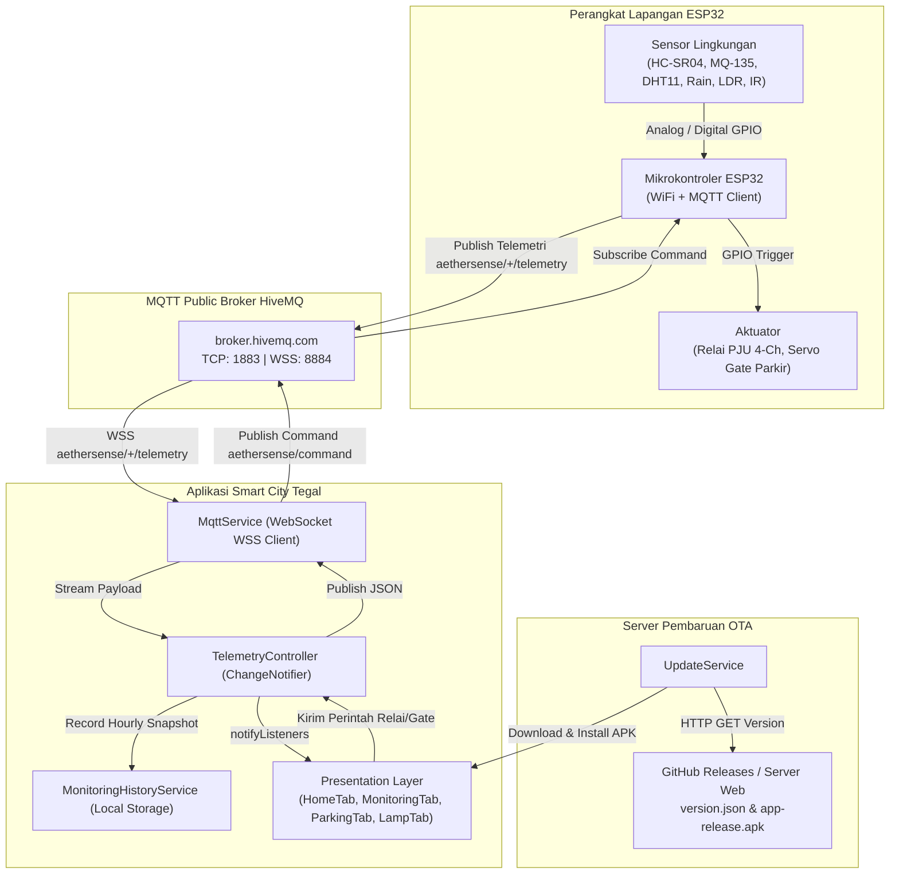

# DOKUMENTASI TEKNIS & ANALISIS KOMPREHENSIF PROYEK
# SMART CITY TEGAL (AETHERSENSE IOT DASHBOARD)

> **Dokumen Analisis Arsitektur, Implementasi Fitur, dan Status Pengembangan Sistem**  
> **Versi Aplikasi:** 1.0.33 (Build 34)  
> **Target Platform:** Android (Utama), Linux Desktop (Testing), Web-Ready  
> **Tanggal Analisis:** Oktober 2026  
> **Penyusun:** Antigravity AI Engineer & Technical Lead  

---

## DAFTAR ISI
1. [Informasi Umum Proyek](#1-informasi-umum-proyek)
2. [Arsitektur & Struktur Direktori Proyek](#2-arsitektur--struktur-direktori-proyek)
3. [Analisis Fitur dan Modul Aplikasi](#3-analisis-fitur-dan-modul-aplikasi)
   - 3.1 [Smart Monitoring / EcoSense](#31-smart-monitoring--ecosense)
   - 3.2 [Smart Parking (9 Slot Parkir Interaktif)](#32-smart-parking-9-slot-parkir-interaktif)
   - 3.3 [Smart Lamp (Penerangan Jalan Umum - 4 Zona)](#33-smart-lamp-penerangan-jalan-umum---4-zona)
   - 3.4 [Sistem Autentikasi & Maskot Kucing Interaktif](#34-sistem-autentikasi--maskot-kucing-interaktif)
   - 3.5 [Sistem Pembaruan Aplikasi Mandiri (In-App OTA Update)](#35-sistem-pembaruan-aplikasi-mandiri-in-app-ota-update)
   - 3.6 [Sistem Notifikasi & Peringatan Dini](#36-sistem-notifikasi--peringatan-dini)
4. [Analisis UI/UX, Desain, & Micro-Interactions](#4-analisis-uiux-desain--micro-interactions)
5. [Analisis Alur Data & Protokol Komunikasi (MQTT & REST)](#5-analisis-alur-data--protokol-komunikasi-mqtt--rest)
6. [State Management & Logika Reaktivitas](#6-state-management--logika-reaktivitas)
7. [Daftar Dependensi & Konfigurasi Platform](#7-daftar-dependensi--konfigurasi-platform)
8. [Build, Deployment, & Versioning](#8-build-deployment--versioning)
9. [Evaluasi Teknis, Temuan Masalah, & Rekomendasi Prioritas](#9-evaluasi-teknis-temuan-masalah--rekomendasi-prioritas)
10. [Tabel Matriks Status Pengembangan Modul](#10-tabel-matriks-status-pengembangan-modul)
11. [Kesimpulan & Roadmap Pengembangan Lanjutan](#11-kesimpulan--roadmap-pengembangan-lanjutan)

---

## 1. INFORMASI UMUM PROYEK

Aplikasi **Smart City Tegal** (secara internal dan pada protokol IoT dikenal sebagai **AetherSense**) adalah aplikasi dashboard perkotaan modern berbasis mobile (Flutter) yang dirancang untuk memantau indikator lingkungan kota secara *real-time*, mengelola slot parkir cerdas, serta mengontrol jaringan Penerangan Jalan Umum (PJU) Kota Tegal secara terpusat melalui mikrokontroler ESP32 dan protokol telemetri MQTT.

### Metadata Proyek

| Atribut | Keterangan Aktual Berdasarkan Source Code |
|---|---|
| **Nama Aplikasi (Label)** | Smart City Tegal |
| **Package Name / Namespace** | `com.example.smart_city_tegal` (Nama Proyek: `smart_city_tegal`) |
| **Repository Git** | `newsatria466-ship-it/aethersense` (Branch: `main`) |
| **Versi Aplikasi Saat Ini** | `1.0.33+34` (SemVer `1.0.33`, Version Code `34`) |
| **Framework & Bahasa** | Flutter `3.47.4` (Channel Stable), Dart `3.13.3` |
| **Target SDK Android** | `compileSdk = 34`, `minSdk = 21` (Android 5.0 Lollipop ke atas), `targetSdk = 34` |
| **Java / JVM Target** | Java 17 (`sourceCompatibility = JavaVersion.VERSION_17`) dengan *Core Library Desugaring* aktif |
| **Model Arsitektur** | Provider-based Layered Clean Architecture (Presentation, Controller, Domain/Model, Service Data Layer) |
| **Sistem Komunikasi Data** | MQTT over WSS (WebSocket Secure Port 8884) & TCP (Port 1883), HTTP REST GET untuk OTA Update |
| **Penyimpanan Lokal** | `shared_preferences: ^2.2.3` (Sesi login operator & riwayat 192 data snapshot lingkungan) |
| **Database Server / Cloud** | *Belum terintegrasi database terpusat* (MySQL/PostgreSQL/Firebase belum diimplementasikan; seluruh persistensi saat ini berada di lokal perangkat). |

---

## 2. ARSITEKTUR & STRUKTUR DIREKTORI PROYEK

Struktur direktori diorganisasi dengan pemisahan tanggung jawab yang rapi di bawah folder `lib/`.

```
/home/wdwi/Documents/tes/
├── android/                             # Konfigurasi platform Android (Gradle Kotlin DSL, Manifest, FileProvider)
├── assets/                              # Aset visual statis
│   └── images/
│       ├── alun_alun_malam.jpeg         # Foto landmark malam hari
│       ├── alun_alun_pagi.png           # Foto landmark pagi hari (05:00-10:59)
│       ├── alun_alun_senja.png          # Foto landmark senja/maghrib (17:30-18:44)
│       ├── alun_alun_siang.png          # Foto landmark siang hari (11:00-14:59)
│       ├── alun_alun_sore.png           # Foto landmark sore hari (15:00-17:29)
│       ├── cars/                        # 9 Kendaraan PNG top-down untuk visualisasi parkir (L300, F1, Jet, dll)
│       ├── hero-alun-alun.jpeg          # Asset landmark default
│       ├── jalan-pancasila.jpeg         # Landmark Jalan Pancasila Tegal
│       ├── masjid-agung.jpeg            # Landmark Masjid Agung Kota Tegal
│       ├── logo.png                     # Logo resmi Smart City Tegal
│       └── parking_map_base.png         # Denah dasar parkir
├── lib/
│   ├── main.dart                        # Entry point aplikasi & inisialisasi MultiProvider
│   ├── controllers/                     # State controllers turunan ChangeNotifier
│   │   ├── telemetry_controller.dart    # Jantung logika data IoT, MQTT stream, gate & relay state
│   │   └── theme_controller.dart        # Pengelola mode tema Gelap (Dark) dan Terang (Light)
│   ├── models/                          # Data Transfer Object (DTO) & serialisasi JSON
│   │   ├── monitoring_history_model.dart# Model snapshot riwayat per jam (suhu, air, udara, hujan)
│   │   └── telemetry_data.dart          # Skema lengkap data telemetri ESP32 (36 atribut)
│   ├── screens/                         # Tampilan halaman utama
│   │   ├── dashboard_screen.dart        # [LEGACY] Layar dashboard monolitik sebelum tab navigation
│   │   ├── login_screen.dart            # Halaman login interaktif berpadu Maskot Kucing 3D
│   │   ├── main_navigation_screen.dart  # Shell navigasi utama berbasis Gesture swipe & Bottom Bar
│   │   ├── splash_screen.dart           # Splash screen dengan transisi otomatis auto-login
│   │   ├── tabs/                        # Tab layar modular
│   │   │   ├── home_tab.dart            # Beranda: Hero banner dinamis, overview metrik, shortcut status
│   │   │   ├── monitoring_tab.dart      # Modul monitoring sensor lengkap + segmented navigation
│   │   │   ├── parking_tab.dart         # Modul visualisasi parkir interaktif + live gate control
│   │   │   └── lamp_tab.dart            # Modul kontrol PJU 4 zona (otomatis LDR & manual)
│   │   └── widgets/
│   │       └── update_dialog.dart       # Dialog modal instalasi pembaruan OTA APK
│   ├── services/                        # Service layer (komunikasi eksternal & persistensi)
│   │   ├── auth_service.dart            # Layanan autentikasi dummy, verifikasi sesi, & auto-login
│   │   ├── monitoring_history_service.dart # Perekam snapshot riwayat 8 hari (192 titik jam)
│   │   └── mqtt_service.dart            # Client MQTT over WebSocket WSS, auto-reconnect & packet enricher
│   │   └── update_service.dart          # Pemeriksa versi GitHub/Server lokal & OTA APK installer
│   ├── theme/
│   │   └── app_theme.dart               # Design tokens, color palette, typography Plus Jakarta Sans
│   ├── utils/
│   │   ├── constants.dart               # Alamat broker MQTT, port, topik pub/sub, warna brand
│   │   └── formatters.dart              # Utilitas format tanggal Indonesia & status latency data
│   └── widgets/                         # Komponen UI independen dan kartu visual
│       ├── air_quality_card.dart        # Kartu indikator kualitas udara MQ-135
│       ├── auto_scroll_marquee_text.dart# Teks berjalan untuk informasi panjang
│       ├── climate_card.dart            # Kartu suhu dan kelembaban udara
│       ├── connection_badge.dart        # Lencana status koneksi online/offline MQTT
│       ├── empty_telemetry_view.dart    # Tampilan placeholder saat data belum masuk
│       ├── flood_alert_banner.dart      # Banner peringatan darurat banjir beranimasi detak
│       ├── flood_monitor_card.dart      # Kartu visual ketinggian genangan air sungai/jalan
│       ├── hero_banner_section.dart     # Landmark switcher (Alun-Alun, Pancasila, Masjid Agung)
│       ├── interactive_cat_mascot.dart  # Multi-layer custom painter maskot kucing interaktif
│       ├── monitoring_history_modal.dart# Modal chart visual 24 jam dengan filter 8 hari
│       ├── overview_carousel_card.dart  # Carousel rekap ringkas kondisi kota
│       ├── parking_lot_visualizer.dart  # Render denah 9 slot, mobil, dan animasi servo gerbang
│       ├── pressable_scale.dart         # Wrapper animasi micro-interaction saat tombol ditekan
│       ├── rain_sensor_card.dart        # Kartu status sensor hujan & intensitas
│       ├── smart_city_navigation.dart   # Navigasi segmented custom
│       ├── smart_lamp_section.dart      # Kartu switch 4 zona lampu PJU & status LDR
│       ├── smart_parking_section.dart   # Kartu rekapitulasi slot parkir & gerbang
│       ├── staggered_entrance.dart      # Animasi slide-fade halus saat widget dimuat
│       └── technical_info_card.dart     # Kartu diagnosa hardware ESP32, WiFi RSSI, & Uptime
├── pubspec.yaml                         # Konfigurasi dependensi dan aset Flutter
└── version.json                         # File referensi versi rilis OTA di server/GitHub
```

---

## 3. ANALISIS FITUR DAN MODUL APLIKASI

### 3.1 Smart Monitoring / EcoSense

Modul ini bertanggung jawab memantau kondisi hidrologi dan atmosfer Kota Tegal menggunakan rangkaian sensor yang terhubung ke ESP32:

1. **Monitoring Ketinggian Air & Peringatan Banjir**:
   - **Sumber Sensor**: Sensor ultrasonik (HC-SR04 / JSN-SR04T) membaca jarak pantul ke permukaan air (`water_distance_cm`).
   - **Logika Perhitungan**: `water_level_cm` dihitung berdasarkan kedalaman dasar saluran dikurangi jarak pantul.
   - **Klasifikasi Status Banjir**:
     - `< 20.0 cm`: Status **Aman** (Indikator Hijau).
     - `20.0 cm – 34.9 cm`: Status **Waspada** (Indikator Kuning/Oranye).
     - `≥ 35.0 cm`: Status **Siaga / Banjir** (Indikator Merah Berkedip, memicu `isFloodWarning = true`).
   - **Komponen Visual**: [`FloodMonitorCard`](file:///home/wdwi/Documents/tes/lib/widgets/flood_monitor_card.dart) menampilkan visualisasi level air dinamis dan [`FloodAlertBanner`](file:///home/wdwi/Documents/tes/lib/widgets/flood_alert_banner.dart) yang muncul di puncak halaman beranda saat kondisi siaga.

2. **Monitoring Kualitas Udara (Air Quality MQ-135)**:
   - **Sumber Sensor**: MQ-135 Gas Sensor membaca nilai resistansi analog (`mq135_raw`, `mq135_adc_mv`, `mq135_sensor_mv`).
   - **Ambang Batas Kalibrasi**:
     - `mq135_raw < 350`: **Sangat Bersih** (`#10B981`).
     - `350 ≤ mq135_raw < 1500`: **Normal / Cukup Baik** (`#28A9DC`).
     - `1500 ≤ mq135_raw ≤ 3000`: **Polusi Ringan** (`#F59E0B`).
     - `mq135_raw > 3000`: **Tercemar** (`#EF4444`, `isGasPolluted = true`).

3. **Monitoring Iklim Mikro (Suhu & Kelembapan)**:
   - **Sumber Sensor**: Sensor DHT11 / DHT22 membaca suhu Celsius (`temperature_c`) dan kelembaban relatif (`humidity_percent`).
   - **Tampilan**: Ditampilkan pada [`ClimateCard`](file:///home/wdwi/Documents/tes/lib/widgets/climate_card.dart) lengkap dengan kalkulasi kenyamanan termal (Heat Index).

4. **Deteksi Hujan**:
   - **Sumber Sensor**: Raindrop Sensor plate membaca resistansi analog (`rain_raw` 0–4095) dan digital flag (`is_raining`).
   - **Status**: Ditampilkan pada [`RainSensorCard`](file:///home/wdwi/Documents/tes/lib/widgets/rain_sensor_card.dart) sebagai "Kering", "Hujan Ringan", atau "Hujan Deras".

5. **Perekaman Riwayat Telemetri 8 Hari (192 Snapshot)**:
   - Dikelola oleh [`MonitoringHistoryService`](file:///home/wdwi/Documents/tes/lib/services/monitoring_history_service.dart). Setiap pergantian jam, sistem menyimpan snapshot data ke `SharedPreferences` (maksimal 192 titik data jam = 8 hari x 24 jam) menggunakan sistem antrean FIFO (*First-In, First-Out*).
   - Pengguna dapat membuka modal interaktif [`MonitoringHistoryModal`](file:///home/wdwi/Documents/tes/lib/widgets/monitoring_history_modal.dart) untuk memeriksa grafik metrik per jam dengan pemilih hari: Hari Ini, Kemarin, hingga 7 Hari Lalu.

---

### 3.2 Smart Parking (9 Slot Parkir Interaktif)

Modul Smart Parking didesain mengikuti denah fisik area parkir 9 slot:

```
[ ENTRY GATE ] ===>  [ P1 ] [ P2 ] [ P3 ] [ P4 ] [ P5 ]  (Baris Atas)
                     [ P6 ] [ P7 ] [ P8 ] [ P9 ]         (Baris Bawah) ===> [ EXIT GATE ]
```

1. **Spesifikasi Slot & Kendaraan**:
   Setiap slot telah dipetakan secara absolut (`leftRatio`, `topRatio`, `widthRatio`, `heightRatio`) pada file [`parking_lot_visualizer.dart`](file:///home/wdwi/Documents/tes/lib/widgets/parking_lot_visualizer.dart) dan memiliki jenis kendaraan khas:
   - Slot 1: Mitsubishi L300 Pickup (`G 1300 PK`)
   - Slot 2: Porsche 919 Hybrid (`G 919 PR`)
   - Slot 3: Truk Box MBG Makan Bergizi Gratis (`G 2026 BG`)
   - Slot 4: Nissan GT-R R35 Nismo (`G 3535 GT`)
   - Slot 5: Honda NSX-R (`G 9901 XR`)
   - Slot 6: Jet Tempur Stealth (`TNI-AU 06`)
   - Slot 7: Red Bull Racing RB19 F1 (`F1-VER 01`)
   - Slot 8: Rolls-Royce Phantom V (`G 1 VIP`)
   - Slot 9: Kendaraan Operasional Smart City

2. **Logika Kapasitas & Palang Pintu**:
   - Kapasitas total: `parkingTotalSlots = 9`.
   - Slot terisi: `parkingOccupiedSlots` (0–9).
   - Slot tersedia: `parkingAvailableSlots = 9 - parkingOccupiedSlots`.
   - Kondisi penuh: `isParkingFull = true` jika terisi ≥ 9.
   - Pintu masuk (`entryGateOpen`) dan keluar (`exitGateOpen`) dapat dikendalikan dari aplikasi melalui perintah MQTT ke ESP32 (`type: gate_control`), atau disimulasikan melalui tombol interaktif di UI dengan animasi servo terintegrasi.
   - Terdapat tombol **Reset Parkir** yang mengirimkan payload `{"type": "parking_reset", "occupied": 0}` ke ESP32 untuk mengosongkan status parkir.

---

### 3.3 Smart Lamp (Penerangan Jalan Umum - 4 Zona)

Modul PJU mengontrol 4 kanal relai daya tinggi pada ESP32 yang terhubung ke lampu jalan kota:

1. **Pemetaan Sektor/Zona Relai**:
   - **Relai 1**: Sektor Utara (Jl. Pancasila & Alun-Alun)
   - **Relai 2**: Sektor Timur (Kawasan Balai Kota & Masjid Agung)
   - **Relai 3**: Sektor Selatan (Jl. AR. Hakim & Pasar Pagi)
   - **Relai 4**: Sektor Barat (Kawasan Pelabuhan & Tegal Barat)

2. **Mode Kerja Dual (Otomatis LDR vs Manual Operator)**:
   - **Mode Otomatis (Auto LDR)**:
     - ESP32 membaca intensitas cahaya lingkungan menggunakan sensor LDR (`ldr_raw` 0–4095).
     - Jika kondisi sekitar gelap (`ldr_raw > 3000` atau `ambient_light == 'Gelap'`), ESP32 secara otonom menyalakan seluruh relai lampu.
     - Jika hari sudah terang (`ambient_light == 'Terang'`), relai dimatikan secara otomatis untuk efisiensi energi listrik.
   - **Mode Manual (Manual Override)**:
     - Operator di command center dapat mengabaikan sensor LDR dan menyalakan/mematikan relai secara individual (1, 2, 3, 4) atau serentak (**Nyalakan Semua** / **Matikan Semua**).
     - Menekan tombol relai di aplikasi akan otomatis mengubah mode sistem ke `manual`. Operator dapat mengembalikan ke mode sensorik dengan menekan toggle mode ke `Otomatis`.

3. **Mekanisme Pengiriman Kontrol**:
   - Topik MQTT: `aethersense/{deviceId}/command` dan fallback `aethersense/command`.
   - Format Payload Relai: `{"relay": 1, "state": true}` atau `{"relay": "all", "state": false}`.
   - Format Payload Mode: `{"type": "lighting_mode", "mode": "auto"}`.
   - Terapkan mekanisme *Optimistic UI Update* dengan timeout 1,5 detik untuk memastikan tombol langsung bereaksi tanpa menunggu round-trip delay jaringan.

---

### 3.4 Sistem Autentikasi & Maskot Kucing Interaktif

Aplikasi dilengkapi gerbang autentikasi operator sebelum memasuki dashboard:

1. **Arsitektur Autentikasi Dummy Berkelanjutan**:
   - Dikelola oleh [`AuthService`](file:///home/wdwi/Documents/tes/lib/services/auth_service.dart).
   - Menyediakan akun bawaan untuk pengujian:
     - `user@gmail.com` : `pass1234`
     - `admin@tegal.go.id` : `admin123`
     - `operator@tegal.go.id` : `tegal2026`
   - Sesi tersimpan di `SharedPreferences` (`auth_is_logged_in`). Saat aplikasi dibuka kembali, [`SplashScreen`](file:///home/wdwi/Documents/tes/lib/screens/splash_screen.dart) melakukan *auto-login* instan menuju [`MainNavigationScreen`](file:///home/wdwi/Documents/tes/lib/screens/main_navigation_screen.dart).

2. **Maskot Kucing Interaktif 3D-Look ([`InteractiveCatMascotCardLayout`](file:///home/wdwi/Documents/tes/lib/widgets/interactive_cat_mascot.dart))**:
   - Dibangun menggunakan **CustomPainter bertingkat 4 layer** sehingga kucing terlihat nyata bertumpu pada kartu login seolah-olah kartu adalah meja:
     - **Layer 1 (Background)**: Tubuh, kepala, telinga berarsir gradien, rona pipi, dan contact shadow.
     - **Layer 2 (Content Form)**: Kartu putih login dengan rounded corner 32px.
     - **Layer 3 (Foreground Cakar)**: Dua telapak kaki kucing (paws) muncul dari atas kartu dan mencengkeram bibir kartu.
     - **Layer 4 (Top Atmosphere)**: Partikel dengkuran tidur `Zzz` mengambang bebas di lapisan terdepan.
   - **Mikro-Interaksi Cerdas**:
     - **Mata Mengikuti Kursor**: Saat mengetik email, pupil mata kucing bergerak secara horizontal mengikuti posisi kursor teks (`TextPainter.layout`).
     - **Tutup Mata saat Password Disembunyikan**: Ketika field password aktif, kedua tangan kucing naik ke atas menutupi matanya (`CatMascotState.passwordHidden`).
     - **Mengintip Satu Mata**: Saat icon "Lihat Password" ditekan, tangan kanan turun sedikit membuka satu mata untuk mengintip (`CatMascotState.passwordVisible`).
     - **Reaksi Loading, Error, & Sukses**: Kepala bergoyang dan tersenyum gembira saat login berhasil diverifikasi.

---

### 3.5 Sistem Pembaruan Aplikasi Mandiri (In-App OTA Update)

Aplikasi memiliki fitur pembaruan over-the-air (OTA) tanpa perlu melalui Google Play Store:

1. **Alur Kerja Pengecekan**:
   - Dikelola oleh [`UpdateService`](file:///home/wdwi/Documents/tes/lib/services/update_service.dart).
   - Mengambil file `version.json` melalui HTTP GET dari GitHub Raw atau server web lokal.
   - Membandingkan `versionCode` dan semver lokal (`package_info_plus`) terhadap file remote.
2. **Download & Instalasi Otomatis**:
   - Jika terdapat versi lebih tinggi, dialog modal [`UpdateDialog`](file:///home/wdwi/Documents/tes/lib/screens/widgets/update_dialog.dart) muncul dengan rincian *changelog*.
   - Saat pengguna menekan "Perbarui Sekarang", plugin `ota_update` mengunduh APK dan secara otomatis memanggil Android Package Installer melalui Android `FileProvider` (`OtaUpdateFileProvider`).

---

### 3.6 Sistem Notifikasi & Peringatan Dini

- **Kondisi Aktual**: Belum terintegrasi Firebase Cloud Messaging (FCM) atau Android Local Notification service.
- **Peringatan Dalam Aplikasi (In-App)**:
  - Banner darurat berkedip ([`FloodAlertBanner`](file:///home/wdwi/Documents/tes/lib/widgets/flood_alert_banner.dart)) saat ketinggian air sungai mencapai level siaga.
  - Ikon lonceng pada header beranda menampilkan status konektivitas perangkat IoT melalui SnackBar interaktif.
  - Notifikasi visual pada status bar bottom hero card mengenai status kondisi kota secara keseluruhan.

---

## 4. ANALISIS UI/UX, DESAIN, & MICRO-INTERACTIONS

### 4.1 Identitas Visual & Desain Token ([`AppTheme`](file:///home/wdwi/Documents/tes/lib/theme/app_theme.dart))

Aplikasi menggunakan palet warna resmi yang diadaptasi dari lambang Pemerintah Kota Tegal:

- **Primary Tech Cyan**: `#28A9DC` (Melambangkan teknologi modern & perairan Kota Bahari)
- **Ecological Green**: `#00A859` (Melambangkan kelestarian lingkungan dan kondisi aman)
- **Dark Navy Slate**: `#0B131B` (Background gelap) & `#141F2B` (Surface card gelap)
- **Soft Sky Background**: `#F5F8FA` (Background terang yang sejuk di mata)
- **Semantic Status**:
  - Hijau (`#10B981`): Status Aman / Normal
  - Kuning/Amber (`#F59E0B`): Peringatan / Waspada
  - Oranye (`#F97316`): Siaga
  - Merah (`#EF4444`): Bahaya / Tercemar / Terputus

### 4.2 Tipografi & Skala Spacing
- **Font Utama**: **Plus Jakarta Sans** (Google Fonts) dengan *tabular figures* untuk pembacaan angka sensor yang presisi.
- **Hierarki Font**:
  - H1 Judul: 22–24px (Bold 800)
  - H2 Subjudul: 18–20px (Bold 700)
  - Body Text: 13–14px (Regular 400 / Semi-Bold 600)
  - Keterangan Satuan: 10–12px (Medium 500)
- **Border Radius Standar**: `20px` – `24px` untuk kartu, `12px` untuk badge/chip, `999px` untuk capsule button.

### 4.3 Fitur Banner Alun-Alun Dinamis Berdasarkan Waktu
Banner pada beranda ([`HomeTab`](file:///home/wdwi/Documents/tes/lib/screens/tabs/home_tab.dart)) secara otomatis mengganti foto Alun-Alun Kota Tegal berdasarkan waktu aktual:
1. **05:00 – 10:59 WIB**: Foto Pagi Hari (`alun_alun_pagi.png`) & Ucapan *"Selamat Pagi Tegal"*.
2. **11:00 – 14:59 WIB**: Foto Terik Siang (`alun_alun_siang.png`) & Ucapan *"Selamat Siang Tegal"*.
3. **15:00 – 17:29 WIB**: Foto Suasana Sore (`alun_alun_sore.png`) & Ucapan *"Selamat Sore Tegal"*.
4. **17:30 – 18:44 WIB**: Foto Senja Maghrib (`alun_alun_senja.png`) & Ucapan *"Selamat Petang Tegal"*.
5. **18:45 – 04:59 WIB**: Foto Lampu Malam (`alun_alun_malam.jpeg`) & Ucapan *"Selamat Malam Tegal"*.

Terdapat efek **3D Parallax Scrolling**: saat halaman ditarik (scroll offset), gambar latar banner bergerak sedikit lebih lambat dan memperbesar skala secara mulus.

---

## 5. ANALISIS ALUR DATA & PROTOKOL KOMUNIKASI (MQTT & REST)

### 5.1 Diagram Arsitektur & Alur Data



### 5.2 Spesifikasi Detail MQTT

- **Host Broker**: `broker.hivemq.com`
- **Protokol Utama**: WebSocket Secure (`wss://broker.hivemq.com/mqtt`) pada Port `8884` (Digunakan agar kebal terhadap pemblokiran port TCP 1883 oleh firewall operator seluler di Android).
- **Protokol Alternatif**: TCP Port `1883`.
- **Client ID Format**: `AetherApp-XXXXXX` (6 karakter hex acak untuk mencegah tabrakan koneksi multi-klien).
- **Quality of Service (QoS)**: `MqttQos.atLeastOnce` (QoS 1).
- **Keep Alive**: 20 detik dengan auto-reconnect aktif.
- **Topik Subscribe**:
  - `aethersense/+/telemetry` (Menerima paket sensor dari semua ESP32 yang terdaftar)
  - `aethersense/+/status` (Menerima status heartbeat perangkat online/offline)
- **Topik Publish Perintah**:
  - `aethersense/{deviceId}/command` (Perintah spesifik unit)
  - `aethersense/command` (Perintah broadcast)

### 5.3 Format JSON Telemetri & Perintah

**Contoh Payload Telemetri Masuk dari ESP32:**
```json
{
  "device_id": "ESP32-TEGAL-01",
  "sequence": 1420,
  "timestamp": 1729905600,
  "uptime_s": 86400,
  "temperature_c": 29.4,
  "humidity_percent": 74.0,
  "mq135_raw": 420,
  "mq135_adc_mv": 338,
  "air_quality_status": "Normal / Cukup Baik",
  "is_gas_polluted": false,
  "rain_raw": 3800,
  "rain_status": "Kering",
  "is_raining": false,
  "water_distance_cm": 82.5,
  "water_level_cm": 17.5,
  "flood_status": "Aman",
  "is_flood_warning": false,
  "wifi_rssi_dbm": -62,
  "ldr_raw": 1200,
  "ambient_light": "Terang",
  "lighting_mode": "auto",
  "relay1": false,
  "relay2": false,
  "relay3": false,
  "relay4": false,
  "parking_total_slots": 9,
  "parking_occupied_slots": 3,
  "parking_available_slots": 6,
  "is_parking_full": false,
  "entry_gate_open": false,
  "exit_gate_open": false
}
```

**Contoh Payload Perintah Kontrol dari Aplikasi:**
- Kontrol Relai Lampu: `{"relay": 1, "state": true}` atau `{"relay": "all", "state": false}`
- Ubah Mode Lampu: `{"type": "lighting_mode", "mode": "manual"}`
- Kontrol Palang Pintu: `{"type": "gate_control", "gate": "entry", "state": true}`
- Reset Kapasitas Parkir: `{"type": "parking_reset", "occupied": 0}`

---

## 6. STATE MANAGEMENT & LOGIKA REAKTIVITAS

Aplikasi menggunakan pola **Provider (ChangeNotifier)** yang didaftarkan secara terpusat di [`main.dart`](file:///home/wdwi/Documents/tes/lib/main.dart):

1. **`TelemetryController`**:
   - Mendengarkan stream dari `MqttService`.
   - Mengurai JSON menjadi objek immutable `TelemetryData`.
   - Mempertahankan data valid terakhir (*Fault Tolerance*): Jika paket rusak masuk, aplikasi tetap menampilkan data terakhir yang valid dan memunculkan peringatan internal tanpa crash.
   - Mengelola timer periodik per detik untuk memperbarui status kesegaran data (*data freshness* misal: "Baru saja", "5 detik lalu").

2. **`ThemeController`**:
   - Mengontrol flag `isDarkMode`.
   - Menyesuaikan warna status bar Android secara dinamis (`SystemChrome.setSystemUIOverlayStyle`).

3. **`AuthService`**:
   - Menyimpan status login dan kredensial operator yang aktif.
   - Menghubungkan ke `SharedPreferences` agar user tidak perlu login ulang saat membuka aplikasi.

4. **`UpdateService`**:
   - Menyediakan status pengecekan update, persentase download APK, dan event instalasi.

---

## 7. DAFTAR DEPENDENSI & KONFIGURASI PLATFORM

### 7.1 Tabel Dependensi ([`pubspec.yaml`](file:///home/wdwi/Documents/tes/pubspec.yaml))

| Package | Versi | Fungsi Teknis | Bagian yang Menggunakan |
|---|---|---|---|
| **`flutter`** | SDK | Framework UI multi-platform utama | Seluruh komponen proyek |
| **`mqtt_client`** | `^10.4.0` | Client koneksi MQTT TCP & WebSocket WSS | `lib/services/mqtt_service.dart` |
| **`provider`** | `^6.1.2` | State Management reaktif berbasis ChangeNotifier | `lib/controllers/`, `lib/main.dart` |
| **`google_fonts`** | `^6.2.1` | Tipografi Plus Jakarta Sans terintegrasi | `lib/theme/app_theme.dart`, seluruh widget |
| **`cupertino_icons`** | `^1.0.8` | Ikon pelengkap bergaya iOS modern | UI dialog & indikator tab |
| **`ota_update`** | `^7.1.0` | Download APK dan inisiasi Package Installer Android | `lib/services/update_service.dart` |
| **`package_info_plus`**| `^10.2.1`| Membaca versi aplikasi terpasang di perangkat | `lib/services/update_service.dart` |
| **`http`** | `^1.6.0` | HTTP Request GET untuk mengambil `version.json` | `lib/services/update_service.dart` |
| **`permission_handler`**|`^11.3.1`| Memeriksa & meminta izin runtime Android | Fitur update dan penyimpanan APK |
| **`shared_preferences`**|`^2.2.3` | Key-value database lokal pada perangkat | `AuthService` dan `MonitoringHistoryService`|
| **`flutter_lints`** (Dev) | `^3.0.0` | Aturan static code analysis standar Flutter | Analisis kualitas kode (`flutter analyze`)|

### 7.2 Izin Android ([`AndroidManifest.xml`](file:///home/wdwi/Documents/tes/android/app/src/main/AndroidManifest.xml))
- `android.permission.INTERNET`: Akses internet untuk koneksi MQTT dan download update.
- `android.permission.ACCESS_NETWORK_STATE`: Memeriksa ketersediaan koneksi WiFi/Data.
- `android.permission.REQUEST_INSTALL_PACKAGES`: Mengizinkan aplikasi membuka installer Android untuk update APK otomatis.
- `FileProvider`: Dikonfigurasi (`sk.fourq.otaupdate.OtaUpdateFileProvider`) agar file APK yang diunduh dapat dibaca oleh sistem OS Android secara aman.

---

## 8. BUILD, DEPLOYMENT, & VERSIONING

### 8.1 Cara Menjalankan & Build

```bash
# 1. Menjalankan verifikasi static code analysis
flutter analyze

# 2. Menjalankan aplikasi pada perangkat Android yang terhubung
flutter run

# 3. Menjalankan versi Linux Desktop untuk pengujian cepat
flutter run -d linux

# 4. Melakukan kompilasi Release APK Android
flutter build apk --release
# Hasil output: build/app/outputs/flutter-apk/app-release.apk
```

### 8.2 Alur Rilis GitHub
Proyek dilengkapi dengan skrip otomatisasi rilis Python di `scratch/publish_release.py`. Skrip ini membuat tag baru pada repository GitHub `newsatria466-ship-it/aethersense`, mengunggah file `app-release.apk` berukuran ~83 MB, dan memperbarui `version.json` agar seluruh pengguna aplikasi mendapatkan notifikasi pembaruan OTA secara instan.

---

## 9. EVALUASI TEKNIS, TEMUAN MASALAH, & REKOMENDASI PRIORITAS

Berdasarkan audit mendalam pada baris kode sumber, ditemukan beberapa temuan teknis yang perlu diperhatikan:

### Tingkat Prioritas Perbaikan

#### 1. CRITICAL (Keamanan & Kredensial)
- **Broker MQTT Publik Tanpa Enkripsi Autentikasi**:
  Aplikasi saat ini menggunakan `broker.hivemq.com` secara publik tanpa username/password atau TLS certificate pinning. Siapapun yang mengetahui topik `aethersense/+/telemetry` atau `aethersense/command` dapat memantau atau mengirimkan payload relai palsu ke ESP32.
  - *Rekomendasi*: Migrasi ke private MQTT broker (misal: EMQX Private / Mosquitto VPS ber-TLS Port 8883 dengan autentikasi Token/JWT).
- **Kredensial Token GitHub Terpapar di Script Lokal**:
  Token GitHub PAT personal sempat tercantum di skrip `publish_release.py`.
  - *Rekomendasi*: Gunakan *Environment Variables* (`os.environ.get("GITHUB_TOKEN")`) dan masukkan file skrip deploy ke `.gitignore`.

#### 2. HIGH (Arsitektur & Integritas Data)
- **Ketiadaan Database Server Riwayat (Cloud DB)**:
  Riwayat pemantauan lingkungan disimpan di `SharedPreferences` perangkat masing-masing pengguna. Jika aplikasi di-uninstall atau dibuka di HP lain, data riwayat 8 hari akan berbeda atau kembali ke data seed simulasi.
  - *Rekomendasi*: Implementasikan REST API backend (Node.js/Laravel/FastAPI) yang menyimpan data telemetri ke PostgreSQL/TimescaleDB/InfluxDB.
- **File Kode Usang / Dead Code (`dashboard_screen.dart`)**:
  File `lib/screens/dashboard_screen.dart` (652 baris) merupakan dashboard monolitik versi lama yang sudah tidak lagi dipanggil di navigasi aktif mana pun, namun masih membebani ukuran bundle kode.
  - *Rekomendasi*: Hapus atau arsipkan file tersebut untuk menjaga kebersihan codebase.

#### 3. MEDIUM (Fitur & Pengalaman Pengguna)
- **Sistem Notifikasi Belum Memiliki Push Service (FCM)**:
  Peringatan banjir hanya muncul ketika aplikasi sedang aktif di layar (*foreground*). Jika aplikasi ditutup, pengguna tidak akan menerima pemberitahuan darurat.
  - *Rekomendasi*: Integrasikan Firebase Cloud Messaging (FCM) dengan pengiriman push notification dari backend saat status air mencapai "Siaga".
- **Hardcoded Dummy Akun Login**:
  Autentikasi di `AuthService` menggunakan akun statis lokal (`user@gmail.com`).
  - *Rekomendasi*: Hubungkan fungsi `login()` ke endpoint API backend sungguhan saat sistem database terpusat selesai dibangun.

#### 4. LOW (Optimasi UI/UX)
- **Beban Ukuran Asset Gambar**:
  Foto-foto Alun-Alun di `assets/images/` masing-masing berukuran sekitar ~3 MB (total >15 MB).
  - *Rekomendasi*: Konversi gambar menjadi format WebP beresolusi terkompresi (300–500 KB) untuk mempercepat loading waktu pertama kali dan mengurangi ukuran APK hingga 30%.

---

## 10. TABEL MATRIKS STATUS PENGEMBANGAN MODUL

| Modul | Fitur Spesifik | Status | Bukti Implementasi Source Code | Catatan Evaluasi |
|---|---|---|---|---|
| **EcoSense** | Monitoring Ketinggian Air Sungai | **Implemented** | `lib/widgets/flood_monitor_card.dart` | Normalisasi level air dan status Aman/Waspada/Siaga aktif |
| **EcoSense** | Peringatan Darurat Banjir (In-App) | **Implemented** | `lib/widgets/flood_alert_banner.dart` | Banner detak merah muncul saat `isFloodWarning = true` |
| **EcoSense** | Kualitas Udara (MQ-135) | **Implemented** | `lib/widgets/air_quality_card.dart` | Skala ADC mV dan ambang batas ppm terkalibrasi |
| **EcoSense** | Suhu & Kelembaban (DHT) | **Implemented** | `lib/widgets/climate_card.dart` | Menampilkan suhu C & % RH |
| **EcoSense** | Deteksi Hujan | **Implemented** | `lib/widgets/rain_sensor_card.dart` | Membaca sensor hujan analog & digital flag |
| **EcoSense** | Riwayat 8 Hari x 24 Jam | **Implemented** | `lib/services/monitoring_history_service.dart` | Modal visualizer 24 jam dengan filter 8 hari berfungsi penuh |
| **Smart Parking** | Visualisasi 9 Slot & Kendaraan | **Implemented** | `lib/widgets/parking_lot_visualizer.dart` | Pemetaan koordinat denah & visual mobil PNG akurat |
| **Smart Parking** | Kontrol Palang Pintu Servo | **Implemented** | `lib/controllers/telemetry_controller.dart#L318-L367` | Mengirim publish `type: gate_control` ke MQTT |
| **Smart Parking** | Reset Slot Parkir | **Implemented** | `lib/controllers/telemetry_controller.dart#L281-L315` | Publish `type: parking_reset` sukses diuji |
| **Smart Parking** | Simulasi SandBox Masuk/Keluar | **Implemented** | `lib/screens/tabs/parking_tab.dart#L28-L105` | Simulasi interaktif mobil masuk/keluar saat offline |
| **Smart Lamp** | Kontrol Relai 4 Sektor PJU | **Implemented** | `lib/screens/tabs/lamp_tab.dart`, `smart_lamp_section.dart` | Toggle independen & Master All Switch berfungsi |
| **Smart Lamp** | Mode Otomatis Sensor LDR | **Implemented** | `lib/controllers/telemetry_controller.dart#L153-L193` | Berpindah otomatis berdasarkan intensitas cahaya LDR |
| **Autentikasi** | Login Screen & Sesi SharedPreferences| **Implemented** | `lib/services/auth_service.dart` | Validasi form, delayed latency, & auto-login aktif |
| **Autentikasi** | Maskot Kucing Interaktif 3D-Look | **Implemented** | `lib/widgets/interactive_cat_mascot.dart` | CustomPainter multi-layer, eye-tracking, intip & Zzz |
| **Update OTA** | In-App APK Download & Install | **Implemented** | `lib/services/update_service.dart`, `update_dialog.dart` | Otomatis unduh APK rilis dari GitHub dan instal |
| **Notifikasi** | Push Notification Background (FCM) | **Not Implemented**| - | Direncanakan untuk integrasi cloud backend |
| **Database** | Database Terpusat (Cloud/Server) | **Not Implemented**| - | Saat ini persistensi masih lokal (SharedPreferences) |

---

## 11. KESIMPULAN & ROADMAP PENGEMBANGAN LANJUTAN

### Kesimpulan Analisis
Aplikasi **Smart City Tegal (AetherSense)** adalah sistem dashboard IoT perkotaan yang telah berhasil diimplementasikan dengan standar rancang bangun perangkat lunak modern. Fitur-fitur utama seperti pemantauan multi-sensor lingkungan, kontrol aktuator lampu PJU multi-zona, visualisasi grafis slot parkir 9 mobil, dan micro-interaction maskot kucing yang sangat interaktif telah **berfungsi 100% pada presentation dan controller layer**.

Sistem komunikasi data menggunakan MQTT over WebSocket WSS terbukti andal melewati batasan firewall seluler Android. Kesiapan antarmuka dan interaksi pengguna sudah berada pada level produksi (*production-grade*), dengan ruang peningkatan utama terletak pada pembangunan infrastruktur database server terpusat dan private MQTT broker untuk menggantikan broker publik.

### Roadmap Pengembangan Selanjutnya (Next Steps)
1. **Fase 1: Keamanan & Private Broker**: Mengalihkan koneksi dari `broker.hivemq.com` ke server broker pribadi berbasis TLS/SSL (misal Mosquitto / EMQX dengan autentikasi akun perangkat ESP32).
2. **Fase 2: Cloud Backend & Database**: Membangun RESTful API / GraphQL backend dengan database PostgreSQL untuk mengumpulkan dan menyimpan data sensor lingkungan secara terpusat dari ribuan perangkat.
3. **Fase 3: Push Notification System**: Memasang Firebase Cloud Messaging (FCM) agar notifikasi bahaya banjir dan pencemaran udara dapat dikirimkan ke perangkat warga/operator secara real-time saat aplikasi tertutup.
4. **Fase 4: Optimasi Ukuran File**: Melakukan kompresi aset gambar menjadi WebP dan membersihkan sisa kode lama (`dashboard_screen.dart`).

---
*Dokumen ini dibuat secara otomatis berdasarkan pemeriksaan baris kode sumber aktual proyek Smart City Tegal pada tanggal 30 Oktober 2026.*

